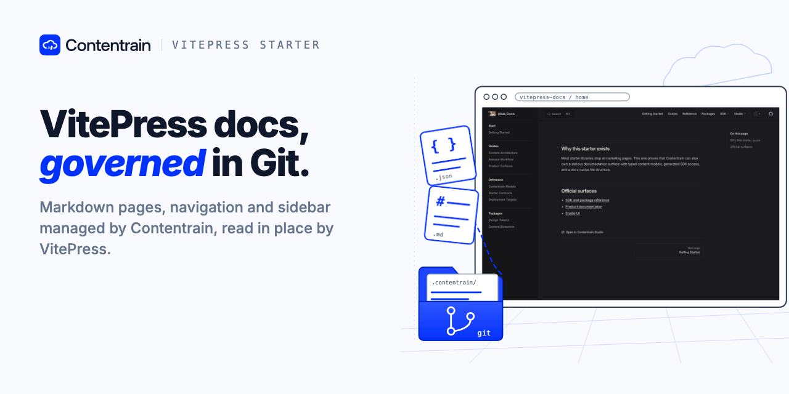
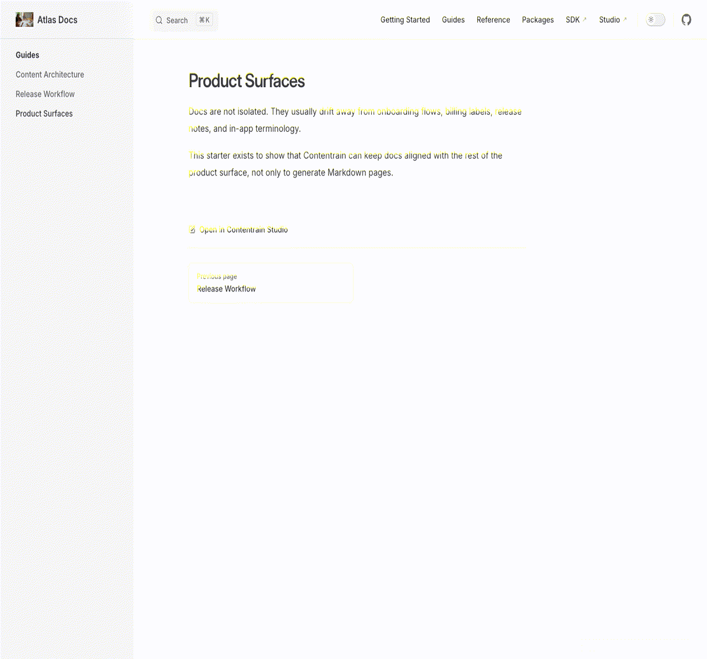

<p align="center"></p>

# Contentrain VitePress Docs

A documentation starter built with VitePress. Its Markdown pages, navigation, and sidebar are managed by [Contentrain](https://ai.contentrain.io), the content governance ecosystem for teams and AI agents.



## What it shows

- Long-form pages as Contentrain `document` models, written straight into the VitePress `docs/` tree through each model's `content_path`. VitePress renders the Markdown files itself.
- The sidebar built from those models in `docs/.vitepress/config.mts` through the generated `#contentrain` client, ordered by each page's `order` field. There are no hard-coded page arrays.
- Site name, navigation, footer, and SEO defaults as singletons, read in the same config.
- Local search, clean URLs, and a static build.

Routes: `/`, `/getting-started`, `/guides/*`, `/reference/*`, `/packages/*` (11 pages, including the 404).

## Use this template

1. Click **Use this template** on GitHub to create your own repository.
2. Optional: connect the new repository in [Contentrain Studio](https://contentrain.io/studio). The repository already contains `.contentrain/`, so Studio opens it as a project. Edits made in Studio are committed to the `contentrain` branch of your repository.

## Quick start

Node 22 and pnpm are required.

```bash
pnpm install
pnpm dev
```

| Command | What it does |
|---|---|
| `pnpm dev` | Start the dev server on port 5175 |
| `pnpm check` | Type-check the VitePress config and theme |
| `pnpm build` | Build the static site into `docs/.vitepress/dist` |
| `pnpm preview` | Serve the built site |
| `pnpm contentrain:generate` | Regenerate the typed client in `.contentrain/client/` |
| `pnpm contentrain:validate` | Validate models and content in `.contentrain/` |

After you change anything in `.contentrain/models`, `.contentrain/content`, or a page's frontmatter, run `pnpm contentrain:generate`.

## Content model

| Model | Kind | Where the content lives | Fields |
|---|---|---|---|
| `docs-page` | document | `docs/` | `title`, `slug`, `description`, `sidebar_label`, `order`, `layout`, Markdown body |
| `guide-page` | document | `docs/guides/` | `title`, `slug`, `description`, `sidebar_label`, `order`, Markdown body |
| `reference-page` | document | `docs/reference/` | `title`, `slug`, `description`, `sidebar_label`, `order`, Markdown body |
| `package-page` | document | `docs/packages/` | `title`, `slug`, `description`, `sidebar_label`, `order`, Markdown body |
| `site-settings` | singleton | `.contentrain/content/system/` | `site_name`, `site_tagline`, `default_locale`, `theme_name`, `og_image` |
| `navigation` | singleton | `.contentrain/content/system/` | `items`, `cta_label`, `cta_href`, `announcement_label` |
| `footer` | singleton | `.contentrain/content/system/` | `blurb`, `columns`, `legal_notice` |
| `seo-defaults` | singleton | `.contentrain/content/system/` | `meta_title`, `meta_description`, `canonical_base`, `og_image` |

Content is in English only.

## Deploy

The build output is a static site in `docs/.vitepress/dist`. `netlify.toml` is included: build command `pnpm deploy:netlify`, publish directory `docs/.vitepress/dist`, Node 22. See [USAGE.md](./USAGE.md) for Netlify CLI steps.

[](https://app.netlify.com/start/deploy?repository=https%3A%2F%2Fgithub.com%2FContentrain%2Fcontentrain-starter-vitepress-docs)

## Contentrain

Contentrain has four parts: the open-source tools, Studio, Migrate and Bridge.

- SDK, CLI, and MCP docs: [ai.contentrain.io](https://ai.contentrain.io)
- Query SDK: [ai.contentrain.io/packages/sdk](https://ai.contentrain.io/packages/sdk)
- Contentrain Studio: [contentrain.io/studio](https://contentrain.io/studio)
- Edit with an AI agent: [@contentrain/mcp](https://ai.contentrain.io/packages/mcp) locally, or [Studio MCP Cloud](https://docs.contentrain.io/developer/mcp-cloud) for teams
- Open-source tools (MIT): [github.com/Contentrain/ai](https://github.com/Contentrain/ai)
- Migrate, WordPress to Astro: [migrate.contentrain.io](https://migrate.contentrain.io)
- Bridge, a free WordPress plugin that exports content as a Contentrain store: [github.com/Contentrain/wordpress-bridge](https://github.com/Contentrain/wordpress-bridge)

## License

[MIT](./LICENSE)
